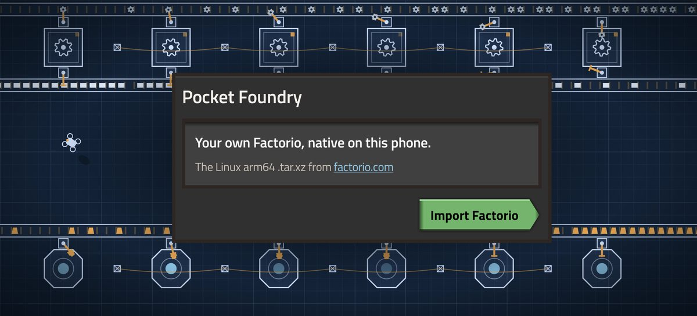
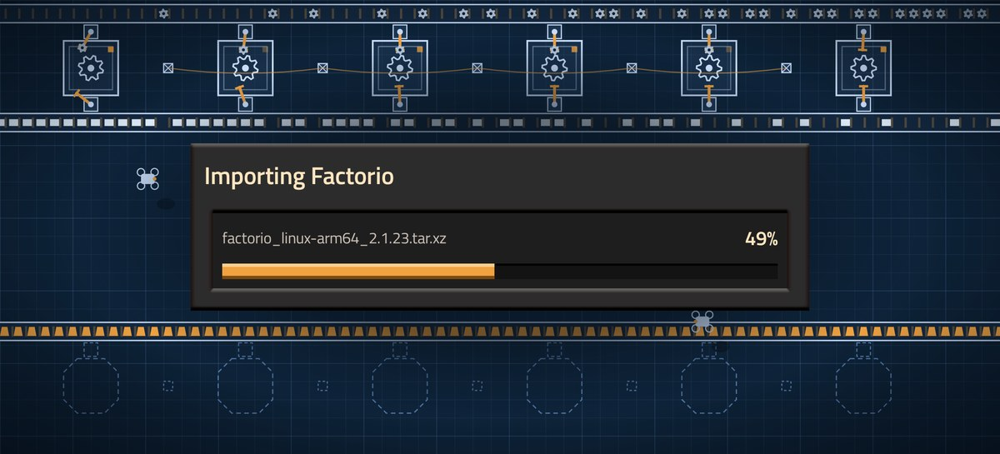
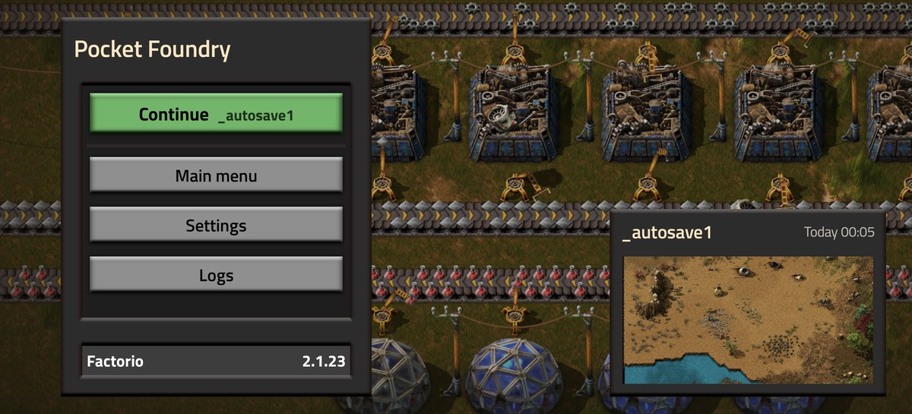
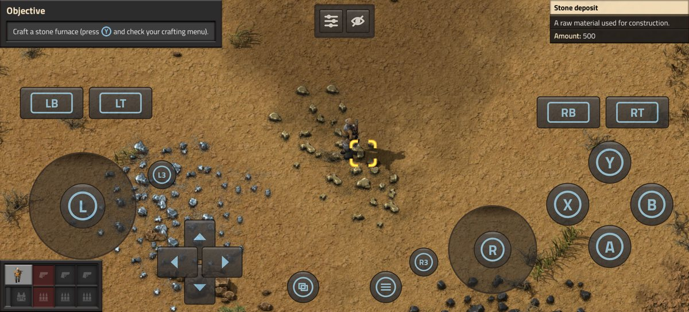

# Pocket Foundry

**Play your own copy of Factorio on Android.** The official Linux ARM64 build runs on the phone itself: no
emulation, no streaming, no game files in the app.

| | |
|---|---|
|  |  |
|  |  |

## Getting started

1. Install the APK from [Releases](https://github.com/JulioFerrero/pocket-foundry/releases).
2. Buy Factorio and download the **Linux (arm64) .tar.xz** from [factorio.com/download](https://factorio.com/download).
3. Open Pocket Foundry, tap **Import Factorio** and pick the file.
4. **Continue** your newest save or open the **Main menu**.

Needs Android 10 or later.

## Phones

| GPU | Found in | |
|---|---|---|
| Adreno 6xx and newer | Snapdragon | Works |
| Xclipse | Exynos (Galaxy S24, S25) | Works with an imported driver |
| Mali | MediaTek, Google Tensor, older Exynos | Some, with an imported driver |
| PowerVR | Pixel 10 | Not yet |
| Adreno 5xx and older | Older Snapdragon | No |

[Phones and drivers](docs/phones.md) has the drivers to import and the phones known to work.

## More

- [Playing](docs/playing.md): controls, controllers, settings and saves
- [Phones and drivers](docs/phones.md)
- [Building and how it works](docs/building.md)
- `NOTES.md`: every finding and decision so far

Something wrong, or it works on your phone? [Open an issue](https://github.com/JulioFerrero/pocket-foundry/issues) with
what the Logs screen shows (its Copy button takes it all).

## Licence

GPL-3.0, as Termux:X11 is. Also bundled: glibc (LGPL-2.1), Mesa (MIT), SDL (zlib), liblzma (0BSD),
Titillium Web (OFL-1.1), Apache Commons Compress and AndroidX (Apache-2.0).

Factorio is © Wube Software. Pocket Foundry isn't affiliated with Wube and includes none of its files; the game
screenshots, the launcher's panels and buttons and the Home screen show art from the player's own copy.
