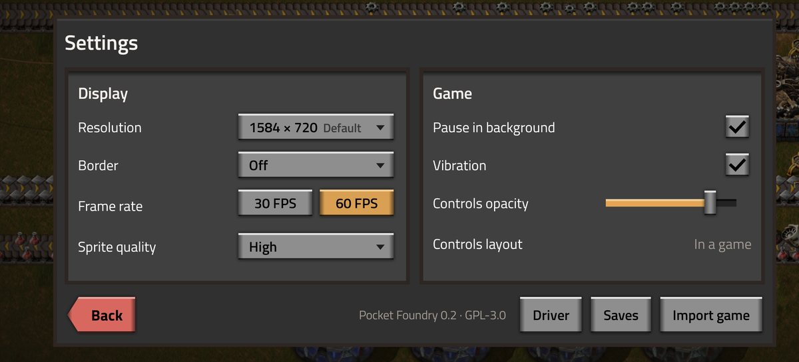
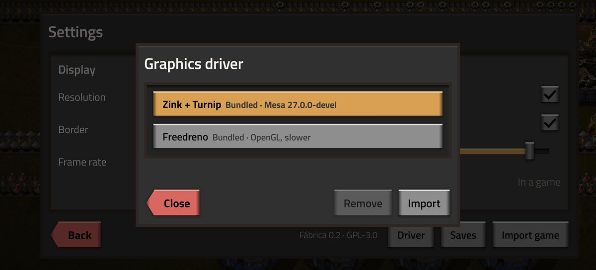
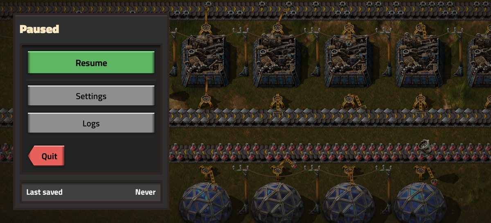

# Pocket Foundry

**Play your own copy of Factorio on Android.** The official Linux ARM64 build from factorio.com runs natively on
the phone's GPU, played with an on-screen controller. No streaming, no Windows emulation, no game files in the app.

| | |
|---|---|
|  |  |
|  |  |

## Playing

1. Buy Factorio and download the **Linux (arm64) .tar.xz** from [factorio.com/download](https://factorio.com/download).
2. Open Pocket Foundry, tap **Import Factorio** and pick the file.
3. **Continue** your newest save or open the **Main menu**. Back opens the pause menu, and the game freezes while
   it's off screen.

Needs Android 10 or later on an Adreno GPU. Tested on a vivo X200 Ultra (Adreno 830, Android 16): 60 FPS and 60 UPS on an early-game save.

## What's in it

- **An on-screen controller in the game's look:** its dark slots, orange while held, its light blue button glyphs.
  Move and resize the controls from the toolbar at the top, or hide them.
- **Settings:** the resolution the game draws at, a 30 or 60 FPS cap (the game keeps 60 updates a second), a frame
  round the game that keeps the screen's rounded corners off its menus, sprite quality (Medium takes ~700 MB off a
  phone's shared memory, for very big saves), pausing in the background, vibration and the controls' opacity.
- **Saves:** export them all to `Download/Pocket Foundry`, where uninstalling leaves them, and import saves from anywhere.
- **Graphics driver:** Zink on Turnip (the default), freedreno, or a newer Turnip you import, such as the
  `turnip_*_arm64.tar.gz` builds from [lfdevs/mesa-for-android-container](https://github.com/lfdevs/mesa-for-android-container/releases).
  Pocket Foundry checks an imported driver can load before keeping it.

| | |
|---|---|
|  |  |

## How it works

- **Your copy, imported:** the archive is unpacked into Pocket Foundry's private storage. The APK carries none of Factorio.
- **A small Linux runtime:** glibc built for Android's paths, Mesa's Zink on Turnip (OpenGL over Adreno's Vulkan),
  Termux:X11's X server as the screen and a tiny window manager. The game binary itself is never modified.
- **Sound and controls through SDL:** the game's static SDL3 hands over to Pocket Foundry's SDL 3.4 through SDL's dynamic
  API. That SDL plays audio through the app, adds a virtual gamepad driven by the on-screen controller (rumble goes
  back to the phone) and paces frames for the 30 FPS cap.
- **The launcher:** Factorio-style panels over a living backdrop. Pocket Foundry's own blueprint, built in 3D (three.js)
  while the game imports, then a working factory drawn from the sprites in your copy.



## Building

```sh
tools/setup.sh                               # Termux:X11 with Pocket Foundry's patches
runtime/build.sh glibc mesa sdl wm assemble  # the Linux runtime, built in Docker
tools/build.sh                               # the debug APK
tools/build.sh :app:assembleRelease          # the release APK
```

Builds are signed with Pocket Foundry's key when `../pocketfoundry-keys/keystore.properties` exists (or `$POCKETFOUNDRY_SIGNING` points
at one), otherwise with the usual debug key. `tools/stage/` regenerates the launcher's scenes and `tools/icon_png.py`
the icon. `NOTES.md` has every finding and decision along the way.

## Licence

GPL-3.0, as Termux:X11 is. Also bundled: glibc (LGPL-2.1), Mesa (MIT), SDL (zlib), liblzma (0BSD), three.js (MIT),
Titillium Web (OFL-1.1), Apache Commons Compress and AndroidX (Apache-2.0).

Factorio is © Wube Software. Pocket Foundry isn't affiliated with Wube and includes none of its files; the game
screenshots and the Home screen show art from the player's own copy.
