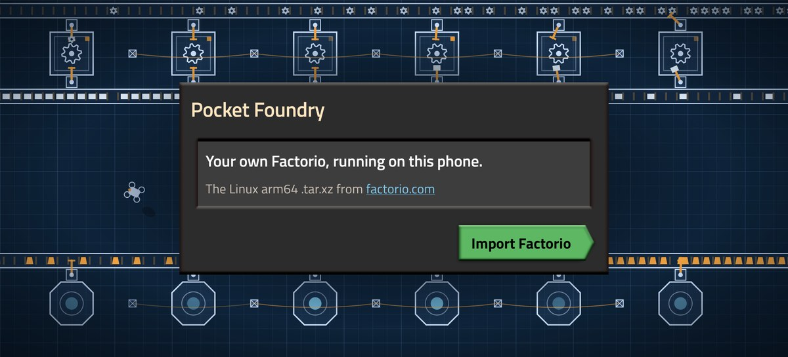
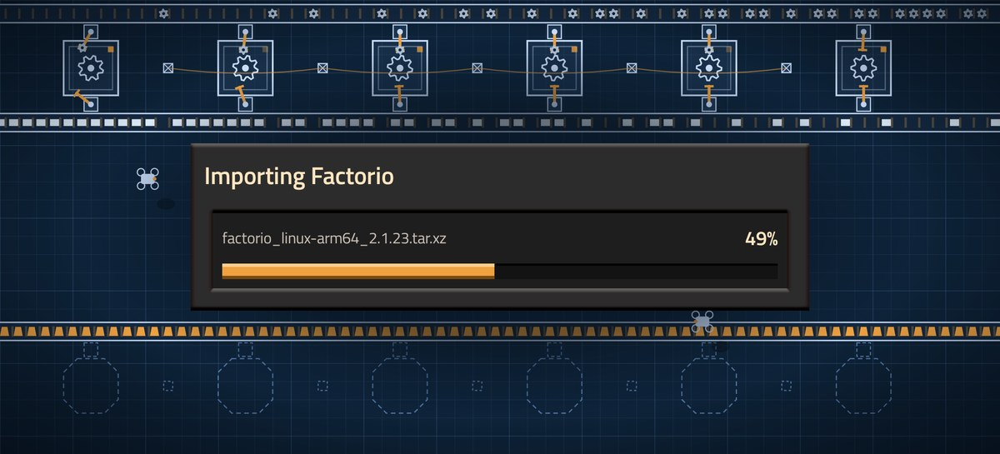
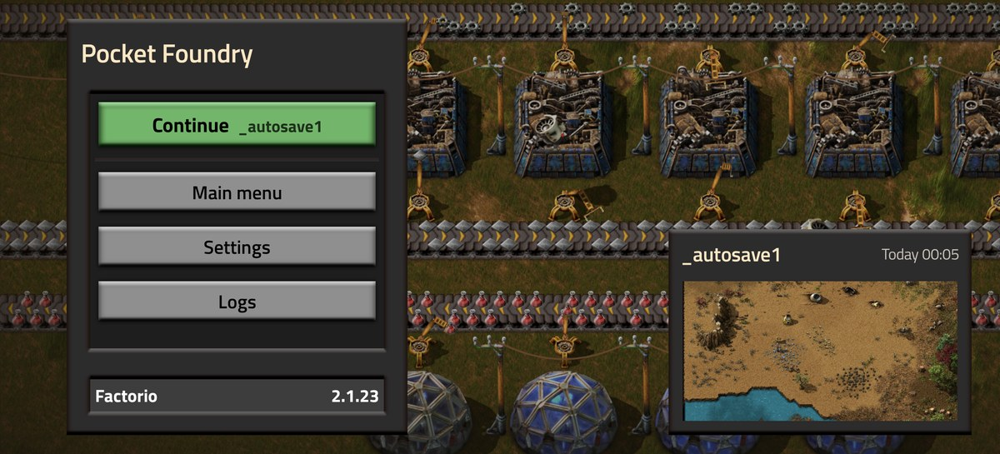
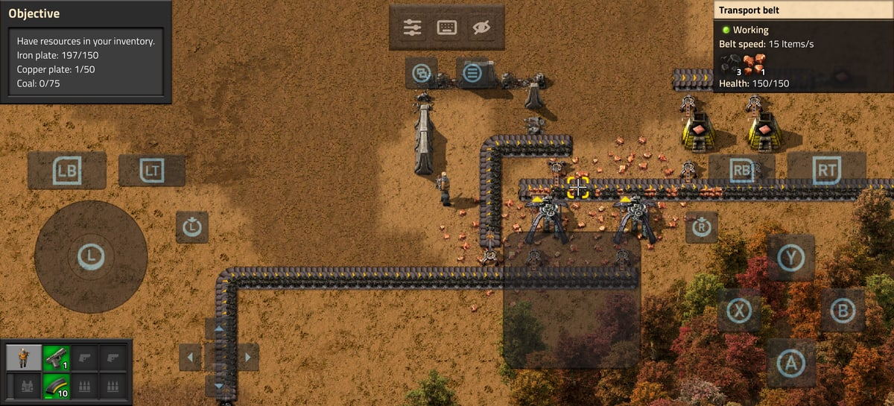

# Pocket Foundry

**Play your own copy of Factorio on Android.** The official Linux ARM64 build runs on the phone itself: no
emulation, no streaming, no game files in the app.

| | |
|---|---|
|  |  |
|  |  |

## Getting started

1. Install Pocket Foundry with [Obtainium](https://github.com/ImranR98/Obtainium), which also brings each new
   version, or the APK from [Releases](https://github.com/JulioFerrero/pocket-foundry/releases).

   

2. Buy Factorio and download the **Linux (arm64) .tar.xz** from [factorio.com/download](https://factorio.com/download).
3. Open Pocket Foundry, tap **Import Factorio** and pick the file.
4. **Continue** your newest save or open the **Main menu**.

Needs Android 10 or later. Pocket Foundry doesn't check for updates itself: Obtainium does.

Releases are signed with the certificate whose SHA-256 is
`0e301617d64bc294bcc2d1dbee71a8c83f8fcc7b7c3616edc26e9b2e89c7e35f`.

## Phones

Pocket Foundry picks the driver for the phone's GPU by itself. If it doesn't start, the next game uses the next one.

| GPU | Found in | Runs with |
|---|---|---|
| Adreno 6xx and newer | Snapdragon | Turnip, downloaded by the app, tested |
| Mali | MediaTek, Google Tensor, older Exynos | The phone's own driver (experimental), or a community driver |
| Xclipse | Exynos (Galaxy S24, S25) | The phone's own driver (experimental), or a community driver |
| PowerVR | Pixel 10, 11 | The phone's own driver, tested on a Pixel 10 Pro |
| Adreno 5xx and older | Older Snapdragon | The CPU |

The phone's own driver is new: reports from Mali, Xclipse and PowerVR phones help.

**Loads, but slow?** It may be on the CPU, where the game ends up when no GPU driver starts, not even MobileGlues.
**Settings -> Driver** shows which one is in use and how the last game with each went.
[Phones and drivers](docs/phones.md) has the community drivers and the phones people report working.

## More

- [Playing](docs/playing.md): controls, controllers, settings, saves and game files
- [Phones and drivers](docs/phones.md)
- [Building and how it works](docs/building.md)

Something wrong, or it works on your phone? [Open an issue](https://github.com/JulioFerrero/pocket-foundry/issues) with
what the Logs screen shows (its Copy button takes it all).

## Licence

GPL-3.0-only, as Termux:X11 is. Also bundled: glibc (LGPL-2.1), Mesa (MIT), SDL (zlib), liblzma (0BSD),
Titillium Web (OFL-1.1), Apache Commons Compress and AndroidX (Apache-2.0). The Phone's driver loads through
[libhybris](https://github.com/taowen/libhybris) (Apache-2.0), whose Vulkan libraries (GPL-3.0) include
[MaliBridge by ASEbrahim](https://github.com/ASEbrahim/MaliBridge), and older phones' drivers get Khronos's timeline
semaphore layer from [Vulkan-ExtensionLayer](https://github.com/KhronosGroup/Vulkan-ExtensionLayer) (Apache-2.0).

Factorio is © Wube Software. Pocket Foundry isn't affiliated with Wube and includes none of its files; the game
screenshots, the launcher's panels and buttons and the Home screen show art from the player's own copy.
