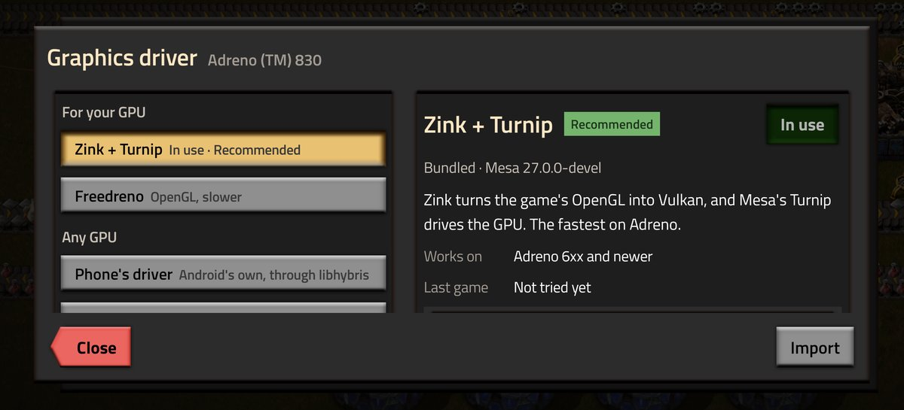

# Phones and drivers

Pocket Foundry draws the game with Mesa's Zink, which runs OpenGL on a Vulkan driver. It picks the driver for the
phone's GPU by itself, marked Recommended in **Settings -> Driver**:

- **Adreno 6xx and newer:** Turnip, which the app downloads the first time it starts. It's the one Pocket
  Foundry tests.
- **Other GPUs with Vulkan 1.1:** the [Phone's driver](#the-phones-driver-any-gpu), experimental.
- **A driver that doesn't start:** the next game uses the next one, down to the [CPU](#any-other-phone-the-cpu).
- **A driver that draws wrong:** before the first game on a driver, Pocket Foundry draws a small test picture with
  it. If the picture comes out wrong, the newer driver features it gets wrong are turned off for every game on it,
  and Logs says which. On a Mali it also tries keeping the game's compressed textures compressed (Malis lack the
  game's format); if they draw right, games use about a third of the texture memory.

The GPU drivers aren't in the app: they come from
[pocket-foundry-drivers](https://github.com/JulioFerrero/pocket-foundry-drivers), where CI builds each one from
source, with the list of phones it was tested on. The app downloads the one for the phone's GPU when it starts, and
again before a game if there's a newer build.

Picking another driver there keeps it; picking the Recommended one hands the choice back. Community drivers can be
imported too (**Settings -> Driver -> Import**). Others make and test them; what's here comes from players' reports,
and a driver's bugs belong to its developers.

**Loads, but slow?** Check **Settings -> Driver**: CPU there means no GPU driver started on the phone. Its Last game
line says how each driver did.

## Adreno 6xx and newer (Snapdragon)

Works out of the box. Tested on a vivo X200 Ultra (Adreno 830, Android 16): 60 FPS and 60 UPS on an early-game save.

A newer Turnip can be imported, such as the `turnip_*_arm64.tar.gz` builds from
[lfdevs/mesa-for-android-container](https://github.com/lfdevs/mesa-for-android-container/releases). Freedreno
(OpenGL straight on the GPU) is in the same list. If text looks garbled, try Freedreno.

## The Phone's driver (any GPU)

Zink on the Vulkan driver the phone already has, loaded through [libhybris](https://github.com/taowen/libhybris)
with [MaliBridge](https://github.com/ASEbrahim/MaliBridge)'s fixes for Mali. Mali, PowerVR and Xclipse phones start
with it. It's experimental: it plays at 60 FPS on an Adreno 830, a Pixel 8's Mali-G715 and a Xiaomi 15T Pro's
Mali-G925. If it doesn't start, the next game runs on the CPU. How it runs on yours: [open an issue](https://github.com/JulioFerrero/pocket-foundry/issues).

## Xclipse (Samsung Exynos)

The [Phone's driver](#the-phones-driver-any-gpu) first. Or import `RADV-Xclipse-upstream-Linux.zip` from
[The412Banner/droiddeck-nonadreno-drivers](https://github.com/The412Banner/droiddeck-nonadreno-drivers/releases/tag/radv-xclipse-upstream).
It's a community build of [JimVulkan/radv-xclipse](https://github.com/JimVulkan/radv-xclipse), not made by Pocket
Foundry. On a Galaxy A56 (Xclipse 540) the Phone's driver crashes and RADV plays
([#62](https://github.com/JulioFerrero/pocket-foundry/issues/62)).

## Mali (MediaTek, Google Tensor, older Exynos)

Malis start on the [Phone's driver](#the-phones-driver-any-gpu). The community driver, PanVK, can be imported in
**Settings -> Driver -> Import**; which one depends on the Mali. Set **Sprite quality** to Medium.

| Mali | Driver | |
|---|---|---|
| G57, G68, G77, G78 | `libvulkan_panfrost-glibc-aarch64.so` from [PanVK-kbase RC3](https://github.com/zenithblue-oss/panvk-kbase-android/releases/tag/panvk-kbase-v0.1.0-rc3) | Plays. The Phone's driver plays on a G57 too, 50–60 FPS ([#51](https://github.com/JulioFerrero/pocket-foundry/issues/51)), on a G68 at 60 FPS ([#64](https://github.com/JulioFerrero/pocket-foundry/issues/64)), and on a G77 at 60 FPS with Medium sprites; High sprites need PanVK there ([#55](https://github.com/JulioFerrero/pocket-foundry/issues/55)) |
| G615 | `libvulkan_panfrost-glibc-aarch64.so` from [PanVK-kbase v26.3.1](https://github.com/zenithblue-oss/panvk-kbase-android/releases/tag/panvk-kbase-v26.3.1), with `DRIRC_CONFIGURATION=pan_enable_vertex_pipeline_stores_atomics=false` in **Settings -> Driver -> Options** (without it the game freezes once a save loads) | Plays. The Phone's driver plays on a G615 too, 60 FPS at native resolution ([#10](https://github.com/JulioFerrero/pocket-foundry/issues/10)) |
| G610, G710 | The G615's, worth a try | The Phone's driver plays on a G710, about 40 FPS with High sprites ([#30](https://github.com/JulioFerrero/pocket-foundry/issues/30)), and on a G610 since 0.8.16, 30–46 FPS with Medium sprites ([#27](https://github.com/JulioFerrero/pocket-foundry/issues/27)). With PanVK, the G615's stops halfway through the sprites on a G710, and the older [PanVK-Mali-G615-Linux.zip](https://github.com/The412Banner/droiddeck-nonadreno-drivers/releases/download/panvk-mali-g615/PanVK-Mali-G615-Linux.zip) gets past the sprites on a G610, then stops |
| G715, G720, G925 | `libvulkan_panfrost-glibc-aarch64.so` from [PanVK-kbase RC3](https://github.com/zenithblue-oss/panvk-kbase-android/releases/tag/panvk-kbase-v0.1.0-rc3), with `PANVK_DEBUG=noafbc,bc_compute` in **Settings -> Driver -> Options** | Reaches the main menu on a G720, slowly. The Phone's driver plays on a G715 ([#13](https://github.com/JulioFerrero/pocket-foundry/issues/13)) and a G925 ([#2](https://github.com/JulioFerrero/pocket-foundry/issues/2)) |
| G52, G72 | The G76's PanVK, under To try: it plays on a G52, 25–32 FPS on a Redmi Note 9 ([#21](https://github.com/JulioFerrero/pocket-foundry/issues/21)) | The Phone's driver plays on a G52, 35–52 FPS with Medium sprites and Light graphics ([#1](https://github.com/JulioFerrero/pocket-foundry/issues/1)), and on a G72 since 0.8.16 ([#59](https://github.com/JulioFerrero/pocket-foundry/issues/59)) |
| G76 | [soulexit/panvk-kirin990](https://github.com/soulexit/panvk-kirin990) v1.2.8, which the app downloads by itself | Plays on a Kirin 980, about 60 FPS ([#56](https://github.com/JulioFerrero/pocket-foundry/issues/56)), and on a Galaxy S10 (Exynos 9820), 29–37 FPS. Reaches the main menu on a Kirin 990, where the Phone's driver loses the GPU |

These are community builds from
[zenithblue-oss/panvk-kbase-android](https://github.com/zenithblue-oss/panvk-kbase-android),
[The412Banner/droiddeck-nonadreno-drivers](https://github.com/The412Banner/droiddeck-nonadreno-drivers) and
[soulexit/panvk-kirin990](https://github.com/soulexit/panvk-kirin990), not made by Pocket Foundry. Releases usually
have a build for Android and one for Linux: Pocket Foundry needs the glibc (Linux) one. soulexit's are Android only,
so the Kirin one is their source built for Linux, unchanged.
Status and reports: [Mali GPUs](https://github.com/JulioFerrero/pocket-foundry/issues/21).

## PowerVR and Adreno 5xx

PowerVR (Pixel 10 and 11) plays on the [Phone's driver](#the-phones-driver-any-gpu): a Pixel 10 Pro with Android 17
at 58-60 FPS with High sprites and Full graphics. Adreno 5xx and older can't run Turnip, and their kernels lack what
freedreno needs: they use the [CPU](#any-other-phone-the-cpu).

## Any other phone: the CPU

**CPU** in **Settings -> Driver** draws the game on the phone's processor with Mesa's llvmpipe, no GPU driver
needed. Phones where no GPU driver starts end up on it, and download it (13 MB) the first time. It's experimental: slow,
and it uses a lot of battery. How fast it runs depends on the processor, not on Pocket Foundry.

Choosing it also sets Medium sprites, **Graphics: Light** (Factorio's smoke, clouds, decoratives, shadows and terrain
effects off) and the lowest resolution, which keeps the same view, only softer. A vivo X200 Ultra runs it at 60 FPS;
phones with slower processors will run lower. How it runs on yours:
[open an issue](https://github.com/JulioFerrero/pocket-foundry/issues).

## Reported working

From players' reports and my own tests on the vivo and on remote test phones.

| Phone | GPU | Driver | |
|---|---|---|---|
| vivo X200 Ultra | Adreno 830 | Turnip | 60 FPS |
| Galaxy S25 Ultra | Adreno 830 | Turnip | 60 FPS ([#69](https://github.com/JulioFerrero/pocket-foundry/issues/69)) |
| OnePlus 15 | Adreno 840 | Turnip | |
| Galaxy S24 Ultra | Adreno 750 | Turnip | |
| Xiaomi 13 | Adreno 740 | Turnip | |
| AYN Thor | Adreno 740 | Turnip | 60 FPS on a big factory save, with its own controls |
| POCO F5 Pro | Adreno 730 | Turnip | 60 FPS ([#20](https://github.com/JulioFerrero/pocket-foundry/issues/20)) |
| Galaxy Z Fold 8 Ultra | Adreno | Turnip | Folded and unfolded |
| Retroid Pocket Flip 2 | Adreno 650 | Turnip | With its own controls |
| Galaxy S20 FE | Adreno 650 | Turnip | Since 0.6.1 ([#12](https://github.com/JulioFerrero/pocket-foundry/issues/12)) |
| Redmi Note 10 Pro | Adreno 618 | Turnip | Since 0.6.2 ([#17](https://github.com/JulioFerrero/pocket-foundry/issues/17)) |
| Nothing Phone (1) | Adreno 642L | Freedreno | Turnip garbles the main menu's text |
| POCO X5 Pro 5G | Adreno 642L | Freedreno | Turnip garbles the text ([#36](https://github.com/JulioFerrero/pocket-foundry/issues/36)) |
| Galaxy S25 FE | Xclipse 940 | [RADV-Xclipse-upstream](https://github.com/The412Banner/droiddeck-nonadreno-drivers/releases/tag/radv-xclipse-upstream) | 60 FPS ([#18](https://github.com/JulioFerrero/pocket-foundry/issues/18)) |
| Galaxy A56 | Xclipse 540 | [RADV-Xclipse-upstream](https://github.com/The412Banner/droiddeck-nonadreno-drivers/releases/tag/radv-xclipse-upstream) | The Phone's driver crashes there ([#62](https://github.com/JulioFerrero/pocket-foundry/issues/62)) |
| Pixel 8 | Mali-G715 | Phone's driver | 60 FPS, Medium sprites ([#13](https://github.com/JulioFerrero/pocket-foundry/issues/13)) |
| Xiaomi 15T Pro | Mali-G925 | Phone's driver | 60 FPS, Medium sprites ([#2](https://github.com/JulioFerrero/pocket-foundry/issues/2)) |
| OnePlus Nord 3 5G | Mali-G710 | Phone's driver | About 40 FPS, High sprites, full graphics ([#30](https://github.com/JulioFerrero/pocket-foundry/issues/30)) |
| Redmi Note 13 Pro+ | Mali-G610 | Phone's driver | 30–46 FPS, Medium sprites, since 0.8.16 ([#27](https://github.com/JulioFerrero/pocket-foundry/issues/27)) |
| Poco X6 Pro | Mali-G615 | Phone's driver | 60 FPS at native resolution ([#10](https://github.com/JulioFerrero/pocket-foundry/issues/10)) |
| Tecno Camon 50 Ultra | Mali-G615 | Phone's driver | 30 FPS on a Space Age save, Medium sprites ([#40](https://github.com/JulioFerrero/pocket-foundry/issues/40)) |
| Xiaomi 11T | Mali-G77 | Phone's driver | 60 FPS, Medium sprites ([#55](https://github.com/JulioFerrero/pocket-foundry/issues/55)). High sprites run out of memory there; [PanVK-kbase RC3](https://github.com/zenithblue-oss/panvk-kbase-android/releases/tag/panvk-kbase-v0.1.0-rc3) plays High at 60 FPS ([#45](https://github.com/JulioFerrero/pocket-foundry/issues/45), [#55](https://github.com/JulioFerrero/pocket-foundry/issues/55)) |
| Galaxy A54 | Mali-G68 | Phone's driver | 60 FPS ([#64](https://github.com/JulioFerrero/pocket-foundry/issues/64)) |
| Poco M6 Pro 4G | Mali-G57 | Phone's driver | 50–60 FPS, 60 UPS ([#51](https://github.com/JulioFerrero/pocket-foundry/issues/51)). 25–30 FPS with [PanVK-kbase RC3](https://github.com/zenithblue-oss/panvk-kbase-android/releases/tag/panvk-kbase-v0.1.0-rc3) ([#25](https://github.com/JulioFerrero/pocket-foundry/issues/25)) |
| Infinix Hot 60i | Mali-G52 | Phone's driver | 35–52 FPS, Medium sprites, Light graphics ([#1](https://github.com/JulioFerrero/pocket-foundry/issues/1)) |
| Redmi Note 9 | Mali-G52 | soulexit's PanVK | 25–32 FPS, Medium sprites, Light graphics ([#21](https://github.com/JulioFerrero/pocket-foundry/issues/21)) |
| Galaxy Tab S6 Lite | Mali-G72 | Phone's driver | 29–60 FPS at 1000×600, Medium sprites, Light graphics, since 0.8.16 ([#59](https://github.com/JulioFerrero/pocket-foundry/issues/59)) |
| Pixel 6 | Mali-G78 | [PanVK-kbase RC3](https://github.com/zenithblue-oss/panvk-kbase-android/releases/tag/panvk-kbase-v0.1.0-rc3) | Medium sprites ([#11](https://github.com/JulioFerrero/pocket-foundry/issues/11)) |
| realme 16 Pro | Mali-G615 | [PanVK-kbase v26.3.1](https://github.com/zenithblue-oss/panvk-kbase-android/releases/tag/panvk-kbase-v26.3.1) with the G615's Options | 60 FPS, High sprites ([#35](https://github.com/JulioFerrero/pocket-foundry/issues/35)) |
| Huawei P30 | Mali-G76 | soulexit's PanVK | About 60 FPS, about 55 with High graphics ([#56](https://github.com/JulioFerrero/pocket-foundry/issues/56)) |
| Pixel 10 Pro | PowerVR DXT-48-1536 | Phone's driver | 58–60 FPS, High sprites, full graphics, since 0.8.17-beta.12 |

Yours works, or doesn't? [Open an issue](https://github.com/JulioFerrero/pocket-foundry/issues) with the Logs
screen's Copy.

## Importing a driver

- Linux (glibc) builds only. Android builds (AdrenoTools, Winlator, emulator packages) can't load in the game.
- A `.tar.gz`, `.tar.xz`, `.zip` or the `.so` alone. Libraries in the package come along.
- Pocket Foundry checks that the driver loads before keeping it.
- Each driver's **Options** pass `NAME=value` settings to it (`PANVK_DEBUG=…`, `TU_DEBUG=…`). Logs shows them.

