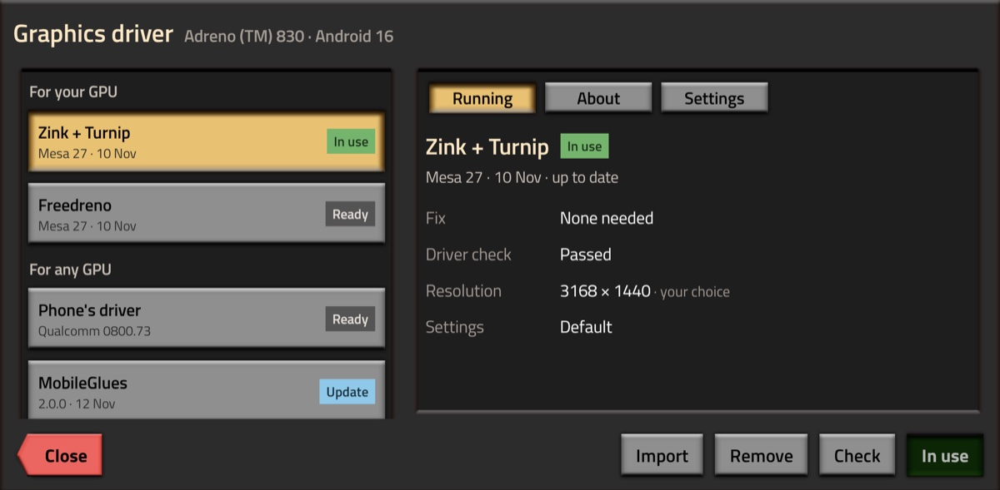

# Phones and drivers

Pocket Foundry picks a graphics driver for your phone's GPU by itself and checks it before the first game, so most
phones need nothing from you. **Settings -> Driver** shows the one in use and lets you pick another.

## What each GPU gets

| GPU | Picked first |
|---|---|
| Adreno 6xx and newer (Snapdragon) | Turnip |
| Mali-G615 | PanVK-kbase 26.3.1 |
| Mali-G77, G78 | PanVK-kbase RC3 |
| Mali-G76 | PanVK 1.2.9 |
| Xclipse (Samsung Exynos) | RADV for Xclipse |
| Other Malis, PowerVR and other GPUs with Vulkan 1.1 | The Phone's driver |
| GPUs without Vulkan 1.1 (Adreno 5xx and older) | MobileGlues |

If the first one can't play, the app moves on by itself: the next one for your GPU, then the Phone's driver, then
MobileGlues, then the CPU.

## The check

Before the first game on a driver, and after each update, Pocket Foundry draws test pictures and the game's textures
with it. From what it sees, not from which GPU it is, it:

- turns off the driver features that draw wrong;
- keeps the textures compressed, a quarter of the memory (a driver that can't, fails);
- turns fast start off where the driver gives the textures back wrong;
- picks High or Medium sprites by the driver's free memory.

**Logs** says what it found.

## The drivers

- **Turnip:** Mesa's open Vulkan driver for Adreno, under Zink. Pocket Foundry is tested on it. **Freedreno**
  (OpenGL straight on the GPU) comes next: try it if the text looks garbled, as on the Adreno 642L.
- **PanVK:** Mesa's open Vulkan driver for Mali, in community builds by
  [zenithblue](https://github.com/zenithblue-oss/panvk-kbase-android) and
  [soulexit](https://github.com/soulexit/panvk-kirin990). Malis they weren't made for find them under **To try**.
- **RADV for Xclipse:** [JimVulkan](https://github.com/JimVulkan/radv-xclipse)'s driver for Samsung's GPUs.
- **The Phone's driver:** the Vulkan driver your phone already has, loaded through
  [libhybris](https://github.com/taowen/libhybris), with [MaliBridge](https://github.com/ASEbrahim/MaliBridge)'s
  fixes for Mali. Experimental.
- **MobileGlues:** turns the game's OpenGL into the phone's own OpenGL ES, without Zink or Vulkan, so it plays where
  the Vulkan drivers don't. **Wait for each frame** in its settings can look smoother on a phone that already reaches
  60 FPS.
- **CPU:** draws on the processor, no GPU needed. Slow and hard on the battery; it sets Medium sprites, Light
  graphics and the lowest resolution.

They all come from [pocket-foundry-drivers](https://github.com/JulioFerrero/pocket-foundry-drivers), where CI builds
each one from source. The app downloads the one it picks, and a newer build when there is one. The community drivers
are made and tested by others, and their bugs belong to their developers.

## Picking a driver yourself

- **Use** switches to another driver. Using the one the app picked hands the choice back to it.
- **Options** pass `NAME=value` settings to a driver (`PANVK_DEBUG=…`, `TU_DEBUG=…`).
- **Import** takes a Linux (glibc) build: a `.tar.gz`, `.tar.xz`, `.zip` or the `.so` alone, or a MobileGlues
  package (`libmobileglues.so` and `libmgx11.so`). Android builds (AdrenoTools, Winlator) can't load in the game.
- **Slow?** If it says CPU, no GPU driver started on your phone:
  [open an issue](https://github.com/JulioFerrero/pocket-foundry/issues) with the Logs.

## Reported working

From players' reports, and tests on the vivo and on remote test phones.

| Phone | GPU | Driver | FPS |
|---|---|---|---|
| vivo X200 Ultra | Adreno 830 | Turnip | 60 |
| Galaxy S25 Ultra | Adreno 830 | Turnip | 60 ([#69](https://github.com/JulioFerrero/pocket-foundry/issues/69)) |
| OnePlus 15 | Adreno 840 | Turnip | |
| Galaxy S24 Ultra | Adreno 750 | Turnip | |
| Galaxy S23 | Adreno 740 | Turnip | 60 |
| Xiaomi 13 | Adreno 740 | Turnip | |
| AYN Thor | Adreno 740 | Turnip | 60 on a big factory |
| POCO F5 Pro | Adreno 730 | Turnip | 60 ([#20](https://github.com/JulioFerrero/pocket-foundry/issues/20)) |
| Galaxy Z Fold 8 Ultra | Adreno | Turnip | Folded and unfolded |
| Retroid Pocket Flip 2 | Adreno 650 | Turnip | |
| Galaxy S20 FE | Adreno 650 | Turnip | [#12](https://github.com/JulioFerrero/pocket-foundry/issues/12) |
| Redmi Note 10 Pro | Adreno 618 | Turnip | [#17](https://github.com/JulioFerrero/pocket-foundry/issues/17) |
| Nothing Phone (1) | Adreno 642L | Freedreno | |
| POCO X5 Pro 5G | Adreno 642L | Freedreno | [#36](https://github.com/JulioFerrero/pocket-foundry/issues/36) |
| Galaxy S25 FE | Xclipse 940 | RADV for Xclipse | 60 ([#18](https://github.com/JulioFerrero/pocket-foundry/issues/18)) |
| Galaxy A56 | Xclipse 540 | RADV for Xclipse | 54–59 ([#62](https://github.com/JulioFerrero/pocket-foundry/issues/62)) |
| realme 16 Pro | Mali-G615 | PanVK-kbase 26.3.1 | 60, High sprites ([#35](https://github.com/JulioFerrero/pocket-foundry/issues/35)) |
| Xiaomi 14T | Mali-G615 | PanVK-kbase 26.3.1 | 46–59, High sprites |
| Poco X6 Pro | Mali-G615 | Phone's driver | 60 ([#10](https://github.com/JulioFerrero/pocket-foundry/issues/10)) |
| Tecno Camon 50 Ultra | Mali-G615 | MobileGlues | 60 ([#76](https://github.com/JulioFerrero/pocket-foundry/issues/76)) |
| Xiaomi 11T | Mali-G77 | PanVK-kbase RC3 | 60, High sprites ([#55](https://github.com/JulioFerrero/pocket-foundry/issues/55)) |
| Galaxy S20 | Mali-G77 | PanVK-kbase RC3 | 37–45 |
| Pixel 6 | Mali-G78 | PanVK-kbase RC3 | Medium sprites ([#11](https://github.com/JulioFerrero/pocket-foundry/issues/11)) |
| Huawei P30 | Mali-G76 | PanVK 1.2.9 | 60 ([#56](https://github.com/JulioFerrero/pocket-foundry/issues/56)) |
| Galaxy S10 | Mali-G76 | PanVK 1.2.9 | 17–37 |
| Pixel 8 | Mali-G715 | Phone's driver | 60, Medium sprites ([#13](https://github.com/JulioFerrero/pocket-foundry/issues/13)) |
| Xiaomi 15T Pro | Mali-G925 | Phone's driver | 60, Medium sprites ([#2](https://github.com/JulioFerrero/pocket-foundry/issues/2)) |
| OnePlus Nord 3 5G | Mali-G710 | Phone's driver | About 40, High sprites ([#30](https://github.com/JulioFerrero/pocket-foundry/issues/30)) |
| Redmi Note 13 Pro+ | Mali-G610 | Phone's driver | 30–46, Medium sprites ([#27](https://github.com/JulioFerrero/pocket-foundry/issues/27)) |
| Galaxy A54 | Mali-G68 | Phone's driver | 60 ([#64](https://github.com/JulioFerrero/pocket-foundry/issues/64)) |
| Galaxy A34 5G | Mali-G68 | MobileGlues | 22–60, Medium sprites, Space Age ([#53](https://github.com/JulioFerrero/pocket-foundry/issues/53)) |
| Poco M6 Pro 4G | Mali-G57 | Phone's driver | 50–60 ([#51](https://github.com/JulioFerrero/pocket-foundry/issues/51)) |
| Galaxy XCover7 | Mali-G57 | MobileGlues | 55–60 |
| Galaxy Tab S6 Lite | Mali-G72 | Phone's driver | 29–60, Medium sprites ([#59](https://github.com/JulioFerrero/pocket-foundry/issues/59)) |
| Infinix Hot 60i | Mali-G52 | Phone's driver | 35–52, Medium sprites ([#1](https://github.com/JulioFerrero/pocket-foundry/issues/1)) |
| Redmi 12C | Mali-G52 | MobileGlues | 50–60 ([#71](https://github.com/JulioFerrero/pocket-foundry/issues/71)) |
| Redmi 12 | Mali-G52 | MobileGlues | 45–60 |
| Redmi Note 9 | Mali-G52 | PanVK 1.2.9 | 25–32 ([#21](https://github.com/JulioFerrero/pocket-foundry/issues/21)) |
| Pixel 10 Pro | PowerVR | Phone's driver | 58–60, High sprites |

Yours works, or doesn't? [Open an issue](https://github.com/JulioFerrero/pocket-foundry/issues) with the Logs
screen's Copy.
