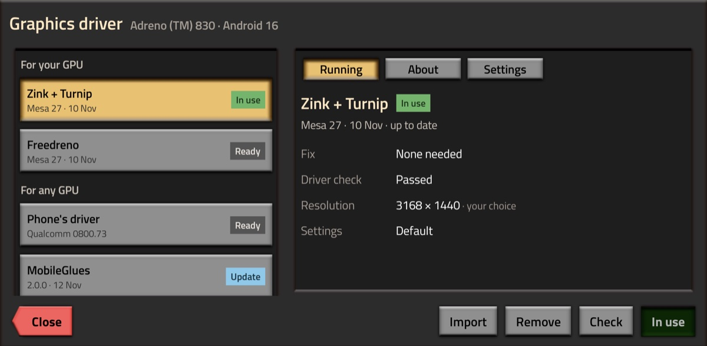

# Phones and drivers

Pocket Foundry picks a graphics driver for your phone's GPU by itself and checks it before the first game, so most
phones need nothing from you. **Settings -> Driver** shows the one in use and lets you pick another.

## What each GPU gets

| GPU | Picked first |
|---|---|
| Adreno 6xx and newer (Snapdragon) | Turnip |
| Mali-G615 | PanVK-kbase 26.3.1 |
| Mali-G77, G78 | PanVK-kbase RC3 |
| Mali-G76 | PanVK 1.2.9 |
| Xclipse (Samsung Exynos) | RADV for Xclipse |
| Mali-G52, G57, G610, G710 | Phone's OpenGL ES |
| Other Malis, PowerVR and other GPUs with Vulkan 1.1 | Phone's Vulkan |
| GPUs without Vulkan 1.1 (Adreno 5xx and older) | Phone's OpenGL ES |

If the first one can't play, the app moves on by itself: the next one for your GPU, then Phone's Vulkan, then
Phone's OpenGL ES (the other way round on the Malis above that get it first), then the CPU.

Where it comes down to Phone's Vulkan and Phone's OpenGL ES, the first start times both, in about 15 seconds, and
the one that drew faster plays.

## The check

Before the first game on a driver, and after each update, Pocket Foundry draws test pictures and the game's textures
with it. From what it sees, not from which GPU it is, it:

- turns off the driver features that draw wrong;
- keeps the textures compressed, a quarter of the memory (a driver that can't, fails);
- turns fast start off where the driver gives the textures back wrong;
- picks High or Medium sprites by the driver's free memory.

**Logs** says what it found.

## The drivers

- **Turnip:** Mesa's open Vulkan driver for Adreno, under Zink. Pocket Foundry is tested on it. **Freedreno**
  (OpenGL straight on the GPU) comes next: try it if the text looks garbled, as on the Adreno 642L.
- **PanVK:** Mesa's open Vulkan driver for Mali, in community builds by
  [zenithblue](https://github.com/zenithblue-oss/panvk-kbase-android) and
  [soulexit](https://github.com/soulexit/panvk-kirin990). Malis they weren't made for find them under **To try**.
- **RADV for Xclipse:** [JimVulkan](https://github.com/JimVulkan/radv-xclipse)'s driver for Samsung's GPUs.
- **Phone's Vulkan:** the Vulkan driver your phone already has, under Zink, loaded through
  [libhybris](https://github.com/taowen/libhybris), with [MaliBridge](https://github.com/ASEbrahim/MaliBridge)'s
  fixes for Mali. Malis from the G52 to the G925 and the Pixel 10's PowerVR play on it.
- **Phone's OpenGL ES:** the OpenGL ES driver your phone already has.
  [MobileGlues](https://github.com/MobileGL-Dev/MobileGlues) turns the game's OpenGL into it, without Zink or Vulkan.
  It needs nothing more than that, so every phone falls back on it before the CPU, and it comes with the app: it plays
  without downloads. Phones whose OpenGL ES driver is ANGLE (the Pixel 11, Galaxy S24 and A56) don't list it:
  ANGLE draws through the phone's Vulkan driver, which Phone's Vulkan reaches directly. It plays on Malis from the G52 to the G925, many at 60 FPS, and on Adreno. **Wait for each
  frame** in its settings can look smoother on a phone that already reaches 60 FPS. **Check** times it.
- **CPU:** draws on the processor, no GPU needed. Slow and hard on the battery; it sets Medium sprites, Light
  graphics and the lowest resolution.

They all come from [pocket-foundry-drivers](https://github.com/JulioFerrero/pocket-foundry-drivers), where CI builds
each one from source. With **Settings -> Driver downloads** on (the app asks once, after the import), it downloads
the one it picks, and a newer build when there is one; they come from outside F-Droid's checks. Without them it plays
on Phone's Vulkan, Phone's OpenGL ES (the app's own build) or an imported one. The community drivers are made and tested by others, and their bugs belong
to their developers.

## Picking a driver yourself

- **Use** switches to another driver. Using the one the app picked hands the choice back to it.
- **Options** pass `NAME=value` settings to a driver (`PANVK_DEBUG=…`, `TU_DEBUG=…`).
- **Import** takes a Linux (glibc) build: a `.tar.gz`, `.tar.xz`, `.zip` or the `.so` alone, or a MobileGlues
  package (`libmobileglues.so` and `libmgx11.so`). Android builds (AdrenoTools, Winlator) can't load in the game.
- **Slow?** If it says CPU, no GPU driver started on your phone:
  [open an issue](https://github.com/JulioFerrero/pocket-foundry/issues) with the Logs.

## Reported working

From players' reports, the game results players share, and tests on the vivo and on remote test phones.

| Phone | GPU | Driver | FPS |
|---|---|---|---|
| vivo X200 Ultra | Adreno 830 | Turnip | 60 |
| Galaxy S25 Ultra | Adreno 830 | Turnip | [60](https://github.com/JulioFerrero/pocket-foundry/issues/69) |
| iQOO Neo11 | Adreno 830 | Turnip | 60, High sprites |
| OnePlus 15 | Adreno 840 | Turnip | |
| REDMAGIC 12 Pro | Adreno 850 | Turnip | 60 at 1553×702, High sprites |
| Galaxy Z Fold (SM-F971U1) | Adreno 840 | Turnip | 60 |
| Galaxy S24 Ultra | Adreno 750 | Turnip | |
| Redmi K80 | Adreno 750 | Turnip | 60, High sprites |
| Galaxy S23 | Adreno 740 | Turnip | 60 |
| Xiaomi 13 | Adreno 740 | Turnip | |
| AYN Thor | Adreno 740 | Turnip | 60 on a big factory |
| POCO F5 Pro | Adreno 730 | Turnip | [60](https://github.com/JulioFerrero/pocket-foundry/issues/20) |
| iQOO Z10 5G | Adreno 810 | Turnip | 55–58 |
| POCO X6 | Adreno 710 | Turnip | 30, its 30 FPS setting |
| Galaxy Z Fold 8 Ultra | Adreno | Turnip | Folded and unfolded |
| Retroid Pocket Flip 2 | Adreno 650 | Turnip | |
| Galaxy S20 FE | Adreno 650 | Turnip | [Plays](https://github.com/JulioFerrero/pocket-foundry/issues/12) |
| POCO F3 | Adreno 650 | Turnip | [30–60, High sprites](https://github.com/JulioFerrero/pocket-foundry/issues/92) |
| realme GT Master Edition | Adreno 642L | Turnip | [15–60, crDroid ROM](https://github.com/JulioFerrero/pocket-foundry/issues/81) |
| Redmi Note 10 Pro | Adreno 618 | Turnip | [Plays](https://github.com/JulioFerrero/pocket-foundry/issues/17) |
| Redmi Note 12 Pro 4G | Adreno 618 | Turnip | 58–60 |
| realme GT 2 Pro | Adreno 730 | Freedreno | 58–60 |
| Nothing Phone (1) | Adreno 642L | Freedreno | |
| POCO X5 Pro 5G | Adreno 642L | Freedreno | [Plays](https://github.com/JulioFerrero/pocket-foundry/issues/36) |
| POCO F9 Ultra | Adreno 840 | Phone's OpenGL ES | 60 |
| Galaxy S25 FE | Xclipse 940 | RADV for Xclipse | [60](https://github.com/JulioFerrero/pocket-foundry/issues/18) |
| Galaxy A56 | Xclipse 540 | RADV for Xclipse | [54–59](https://github.com/JulioFerrero/pocket-foundry/issues/62) |
| Galaxy S24 FE | Xclipse 940 | RADV for Xclipse | [60, maximum graphics](https://github.com/JulioFerrero/pocket-foundry/issues/94) |
| realme 16 Pro | Mali-G615 | PanVK-kbase 26.3.1 | [60, High sprites](https://github.com/JulioFerrero/pocket-foundry/issues/35) |
| Xiaomi 14T | Mali-G615 | PanVK-kbase 26.3.1 | 46–59, High sprites |
| Poco X6 Pro | Mali-G615 | PanVK-kbase 26.3.1 | 60, High sprites |
| Poco X6 Pro | Mali-G615 | Phone's Vulkan | [60](https://github.com/JulioFerrero/pocket-foundry/issues/10) |
| Tecno Camon 50 Ultra | Mali-G615 | Phone's OpenGL ES | [60](https://github.com/JulioFerrero/pocket-foundry/issues/76) |
| Tecno Pova 7 Ultra 5G | Mali-G615 | Phone's OpenGL ES | [60, Medium sprites](https://github.com/JulioFerrero/pocket-foundry/issues/77) |
| realme P4 5G | Mali-G615 | Phone's OpenGL ES | 58–59 |
| Xiaomi 11T | Mali-G77 | PanVK-kbase RC3 | [60, High sprites](https://github.com/JulioFerrero/pocket-foundry/issues/55) |
| Galaxy S20 | Mali-G77 | PanVK-kbase RC3 | 37–45 |
| Pixel 6 | Mali-G78 | PanVK-kbase RC3 | [Medium sprites](https://github.com/JulioFerrero/pocket-foundry/issues/11) |
| Huawei P30 | Mali-G76 | PanVK 1.2.9 | [60](https://github.com/JulioFerrero/pocket-foundry/issues/56) |
| Galaxy S10 | Mali-G76 | PanVK 1.2.9 | 17–37 |
| Redmi Note 10S | Mali-G76 | Phone's OpenGL ES | [54–60](https://github.com/JulioFerrero/pocket-foundry/issues/85) |
| HUAWEI nova 5T | Mali-G76 | Phone's OpenGL ES | 53–60 |
| Pixel 8 | Mali-G715 | Phone's Vulkan | [60, Medium sprites](https://github.com/JulioFerrero/pocket-foundry/issues/13) |
| Pixel 9 Pro | Mali-G715 | Phone's OpenGL ES | 58–60 |
| Pixel 9 Pro XL | Mali-G715 | Phone's OpenGL ES | 42–60 |
| Pixel 10a | Mali-G715 | Phone's OpenGL ES | 30, its 30 FPS setting |
| Xiaomi 15T Pro | Mali-G925 | Phone's Vulkan | [60, Medium sprites](https://github.com/JulioFerrero/pocket-foundry/issues/2) |
| Xiaomi 15T Pro | Mali-G925 | Phone's OpenGL ES | 57–60 |
| iQOO Z10 Turbo+ | Mali-G925 | Phone's OpenGL ES | 57–60 |
| Redmi Turbo 4 | Mali-G720 | Phone's OpenGL ES | 60 |
| OnePlus Nord 3 5G | Mali-G710 | Phone's OpenGL ES | [60, highest settings](https://github.com/JulioFerrero/pocket-foundry/issues/30) |
| Redmi Note 13 Pro+ | Mali-G610 | Phone's Vulkan | [30–46, Medium sprites](https://github.com/JulioFerrero/pocket-foundry/issues/27) |
| Redmi Note 13 Pro+ | Mali-G610 | Phone's OpenGL ES | 44–59 |
| Galaxy A54 | Mali-G68 | Phone's Vulkan | [60](https://github.com/JulioFerrero/pocket-foundry/issues/64) |
| Galaxy A34 5G | Mali-G68 | Phone's OpenGL ES | [22–60, Medium sprites, Space Age](https://github.com/JulioFerrero/pocket-foundry/issues/53) |
| Poco M6 Pro 4G | Mali-G57 | Phone's Vulkan | [50–60](https://github.com/JulioFerrero/pocket-foundry/issues/51) |
| Galaxy XCover7 | Mali-G57 | Phone's OpenGL ES | 55–60 |
| Redmi Note 10T 5G | Mali-G57 | Phone's OpenGL ES | [50–60](https://github.com/JulioFerrero/pocket-foundry/issues/86) |
| Ulefone Armor 33 | Mali-G57 | Phone's OpenGL ES | 47–60 |
| realme C61 | Mali-G57 | Phone's OpenGL ES | 52–57 |
| Galaxy Tab S6 Lite | Mali-G72 | Phone's Vulkan | [29–60, Medium sprites](https://github.com/JulioFerrero/pocket-foundry/issues/59) |
| Infinix Hot 60i | Mali-G52 | Phone's Vulkan | [35–52, Medium sprites](https://github.com/JulioFerrero/pocket-foundry/issues/1) |
| Redmi 12C | Mali-G52 | Phone's OpenGL ES | [50–60](https://github.com/JulioFerrero/pocket-foundry/issues/71) |
| Redmi 12 | Mali-G52 | Phone's OpenGL ES | 45–60 |
| Redmi 13C | Mali-G52 | Phone's OpenGL ES | [60](https://github.com/JulioFerrero/pocket-foundry/issues/78) |
| vivo Y33s | Mali-G52 | Phone's OpenGL ES | 15–23, its 30 FPS setting |
| Redmi Note 9 | Mali-G52 | PanVK 1.2.9 | [25–32](https://github.com/JulioFerrero/pocket-foundry/issues/21) |
| Pixel 10 Pro | PowerVR | Phone's Vulkan | 58–60, High sprites |
| Pixel 11 | PowerVR | Phone's Vulkan | [50–60](https://github.com/JulioFerrero/pocket-foundry/issues/65#issuecomment-7220899075) |

Yours works, or doesn't? [Open an issue](https://github.com/JulioFerrero/pocket-foundry/issues) with the Logs
screen's Copy.
