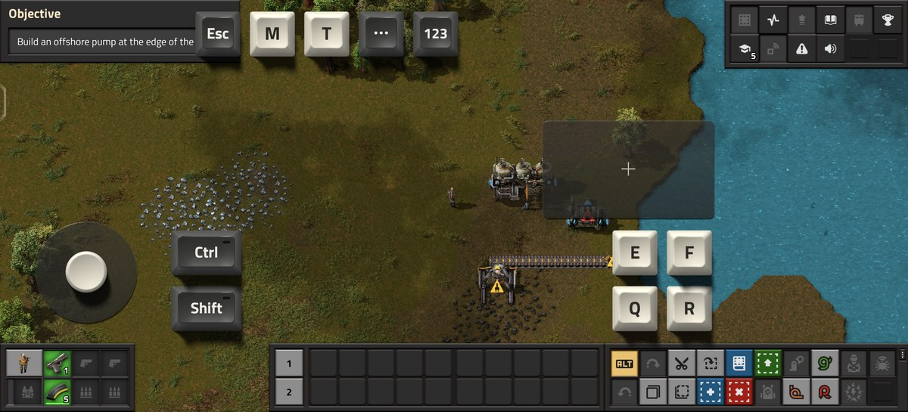
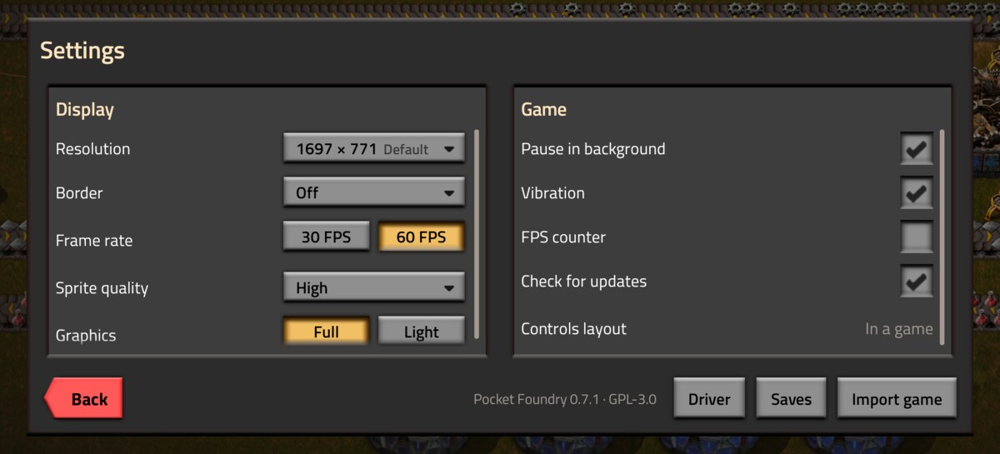
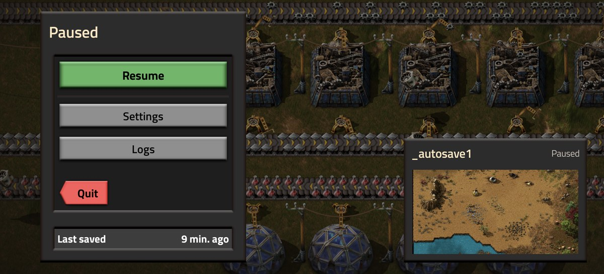

# Playing

## Controls

Factorio runs in its gamepad mode, so its hints and the tutorial ("press A", "hold LB") name the buttons on screen.
Your finger is the cursor: touch the game where you want something to happen.

| On the game | What it does |
|---|---|
| Tap | Moves the cursor there and acts on it, like A: places what you hold, opens what's there. In menus, it clicks. |
| Double tap, keep the finger down and drag | Holds A along the way: a line of belts or pipes. |
| Long press | Mines what's under the finger (holds X); drag to keep mining. **Settings -> Long press** changes or disables it. |
| Two-finger tap | B: closes a menu, goes back, dismisses a tutorial tip. |
| Pinch | Zooms in and out. |

The square on the right is a trackpad, like a laptop's or the Steam Deck's: drag in it and the cursor moves by how far
you drag, so your finger never covers what you point at. Tap in it to act where the cursor is, long press for X, and
double tap and hold to hold A while you drag. **Settings -> Touch** changes it: **Direct** puts a right stick there
instead, **Trackpad** makes the whole screen a trackpad, and **Trackpad speed** sets how far the cursor goes.
**Long press** sets how long you hold before it acts, or turns it off.

| Button | In Factorio |
|---|---|
| Left stick | Walk. |
| Trackpad (the square on the right) | Moves the cursor, see above. A right stick with Touch on Direct. |
| R3 (the small R above it) | Shows a cross next to the player, which the trackpad or right stick moves. |
| Y (the largest) | Inventory and crafting. |
| A | Build, open, craft, pick up. |
| X | Mine, craft 5. |
| B | Close, back, empty the hand. |
| LB (hold) | Quick panel: items and tools without opening the inventory. |
| RT, LT | Held with another button for more: RT + A builds a ghost, LT + map opens research. |
| RB | Shoot. |
| D-pad | Right rotates, down picks up items, up shows details on the map. |
| The two under the toolbar | Map and game menu. |

The toolbar at the top moves and resizes the buttons (pinch one), removes them and adds them back, fades or hides
them all, and opens the phone's keyboard, for naming a save. **Settings -> Controls -> Edit layout** opens the same
editor without a game, over your newest save's picture, for the controls chosen there. Faded to 0% they don't show but still work; the editor
shows them, and the percentage by its fade key. Back, or a controller's
home button, opens the pause menu; the game freezes while it's off screen.

## Mouse & keys

**Settings -> Controls -> Mouse & keys** plays Factorio as on a computer, with its PC menus and keys. The next game
starts that way; a controller connected at the start still gets the gamepad.

Your finger is the mouse:

| On the game | What it does |
|---|---|
| Tap | Click: build, open, pick up a stack. |
| Long press | Right click: mine, remove, take half a stack. Drag to keep mining. |
| Drag | Holds the click: belts and pipes in a line, a stack dragged. |
| Double tap, keep the finger down a moment, then drag | Holds the click from there, with the trackpad too: belts in a line, a repair held. A finger that moves at once only moves the cursor. |
| Pinch | Zooms, as the mouse wheel. |
| Two-finger drag | Scrolls lists, recipes and the tech tree. |
| Two-finger tap | Esc: closes what's open, and brings back the game's keys. |
| Three-finger tap | Middle click. |

**Touch** in the editor (the fingertip) changes what the long press, double tap and hold, and the two- and
three-finger taps do: any key, a combination or a mouse button, or nothing. **Long press after** there sets how long
you hold first, as **Settings -> Long press** does.

With **Touch -> Box** (the default) the gamepad's trackpad is there too, over E and F: drag in it and the cursor
moves by how far you drag, so your finger doesn't hide what it points at, and what it shows when the cursor is over
it (a machine's recipe, a belt's contents). A tap acts where the cursor is; a move, however small, leaves it where it
went, with no click. **Trackpad** makes the whole screen a trackpad, **Direct** leaves it out. Edit keys moves it,
resizes it or removes it, as any key.

The keys on screen are Factorio's own, as large as a thumb's target and kept where thumbs reach, off the middle of
the screen (the game's) and off Factorio's own panels:

- **Right thumb**, left of the minimap: E (inventory), F (pick up), Q (pipette) and R (rotate), R nearest.
- **Left thumb:** the stick (W, A, S and D, two at once on a diagonal), and Shift and Ctrl beside it. **Shift and Ctrl
  stay held** when tapped, their light on, till they're tapped again: Shift or Ctrl, then a tap on a chest, moves a
  stack or everything of a kind.
- **Along the top**, the keys pressed least: Esc, M (map), T (research), the drawer, and **123**: a number pad
  (Backspace and Enter too) for combinators and trains.
- **The drawer** (the dots): Alt (details), Z (drop), Space (shoot), X (the next quickbar row), Undo, Copy, Paste, the
  phone's keyboard, **Edit keys** and **Hide keys**.

The keys follow the screen: E (and T, P) brings the inventory's keys, Shift, Ctrl and one to close it; M brings the
map's, the stick and the top keys. The same key again, Esc or a two-finger tap brings back the game's. A window
closed with its own ✕ leaves the inventory's keys up: Esc or a two-finger tap puts them right.

**Edit keys** works as the gamepad's layout editor, its tools at the bottom: drag a key, pinch it. **Add** lists,
as the gamepad's does, the keys the screen doesn't have, each with what it does (Ctrl+Z Undo), and:

- **New key:** a whole keyboard, F keys, arrows and Space included, and the mouse's three buttons under Space. Ctrl,
  Shift and Alt switched on first make a combination: Ctrl+F, Shift+R, Shift+Left click.
- **Left click, Right click and Middle click:** a laptop's buttons. While one is held, a finger on the game only moves
  the cursor, and the button drags with it: hold Left and drag on the trackpad to lay belts. With Touch on Direct the
  cursor first jumps to the finger, the button let go on the way, so nothing is dragged from where it was.
- **Sets:** a key for each other set, with its name on it, that only brings that set.

**Options** (the sliders) is the key picked's: what it sends (Change opens the keyboard), its width as on a keyboard
(1u for a letter up to 6.25u for Space), how it presses, and which set it brings, if any. **Press** is while touched,
stays held like Shift (tapped again to let go), or a long press of 0.3 to 1 s, for a key that shouldn't go by a brush
of the thumb: it shows a clock, and acts once held that long. E, M and
the rest bring theirs that way, and can be changed. Letters, numbers and signs get the pale cap, the rest the darker
one.

**In game**, **Inventory** and **Map**, top left, pick which keys to edit. **+** makes a set of your own, for trains,
fighting or blueprints, named as you like; picked again, its chip renames or deletes it. It starts with the stick,
Esc and the drawer. Picking the drawer opens it: a key dragged off it comes onto the screen, one let go of over it
goes in, and Add puts the key in it while it's open.

## Controllers

USB or Bluetooth: Xbox, PlayStation, Switch Pro, 8BitDo, phone clamps.

- The on-screen buttons step aside as soon as you use one, and come back when it's unplugged. A handheld's own
  controls count from the start.
- Touch still moves the cursor, and the game's rumble comes through the controller.
- The launcher takes it too: the D-pad or stick moves between buttons, A picks and B goes back.
- The game names the buttons the Xbox way; Factorio's own settings can show PlayStation or Switch symbols instead.
- **Settings -> Controls -> Controller buttons** moves what Factorio's own settings can't: a button the game never
  sees (C, Z, paddles, numbered ones) can be any of the pad's, and A and B can swap, in the launcher too. Tap one of
  the game's buttons, then press the controller's button for it; Reset puts them back. Each controller keeps its own.

## Keyboards

Connected when the game starts without a controller, a USB or Bluetooth keyboard puts Factorio in its
keyboard-and-mouse mode and the on-screen controls step aside. A mouse points and clicks as on a computer; touch
still works as the mouse too.

## Settings

- **Resolution** the game draws at. Default comes from the screen's density, so the game looks the same size on any
  phone. The two below it, the lowest marked CPU, keep the same view with fewer pixels.
- **Frame rate** capped at 30 or 60 FPS; the game keeps 60 updates a second.
- **A frame** round the game, which keeps the screen's rounded corners off its menus.
- **Sprite quality:** Medium takes about 700 MB off the phone's shared memory, for very big saves or Mali GPUs.
- **Graphics:** Light turns off Factorio's smoke, clouds, decoratives, particles, shadows and terrain effects, which
  roughly halves what the phone draws. Full puts them back.
- **Driver:** see [Phones and drivers](phones.md).
- **FPS counter** in the game's top-left corner.
- **Fast start:** Factorio keeps the sprite atlases it builds on the phone's storage (about 130 MB for the base game
  with Medium sprites, shown next to it), so every start after the first loads in seconds and with a third less
  memory. It builds them again when the sprites, the mods or the driver's texture compression change. Off, it frees
  the room.
- **Fast CPU:** while the game falls behind its frame rate, Pocket Foundry keeps the phone's fast cores looking busy
  at the lowest priority, which takes no time from the game but keeps their clocks up. The phone gets warmer and the
  battery goes faster. It stops when the game keeps up without it, when the phone reports heat and with battery saver
  on. On MediaTek phones the game also tells their own booster about its frames, which raises the clocks only as far
  as each frame needs, and Fast CPU stays off while the booster has the game. On a Xiaomi 12T a heavy map went from 18
  to 54 FPS with Fast CPU, and to 57-59 with the booster. It's on by default only on MediaTek phones: on a POCO F3's
  Snapdragon it made the frame rate lower and jumpy.
- **Detailed logs:** for a problem report. Logs then also shows how the game's frames get to the screen and every
  graphics error. A black screen or a frozen picture shows where it happens. Turn it on, play until
  the problem shows, then copy the Logs.
- **Share results:** off until you say yes; Pocket Foundry asks once, after your first game. Then after each game it
  sends how it ran to reports.pocketfoundry.dev: the phone's model and Android version, the GPU, the driver and its
  version, Factorio's version, the resolution, sprites and graphics, Fast CPU, the FPS, the minutes played and how
  the game ended, with the logs when it didn't end well: it didn't start, failed or stopped, it was quit after a minute
  or more still loading, or Android closed the app during it (sent at the app's next start). No saves, no account and
  nothing that names you, only a random id the install makes for itself, which Settings shows. It shows which driver
  plays best on each phone.
- **Logs -> Report** sends the Logs, as a file, and what you write to Pocket Foundry's developer at
  reports.pocketfoundry.dev, privately, when you tap Send. Its GitHub button opens a public issue instead.
- **Privacy:** what reports and results hold, how long they're kept and how to have yours deleted:
  [pocketfoundry.dev/privacy](https://pocketfoundry.dev/privacy/).
- **Driver downloads:** the driver list and its drivers, from
  [pocket-foundry-drivers](https://github.com/JulioFerrero/pocket-foundry-drivers) on GitHub, outside F-Droid's
  checks. Pocket Foundry asks once, after the import; without them it plays on the phone's own driver or an
  imported one.
- **Controls:** the gamepad, or [Mouse & keys](#mouse--keys), for the next game.
- Pausing in the background, and vibration.

## Updates

Pocket Foundry doesn't check for updates itself. [Obtainium](https://github.com/ImranR98/Obtainium) does: add
Pocket Foundry with the button in the [README](../README.md#getting-started), or paste this repository's link into
Obtainium, and it tells you when a new version is out and installs it. Each version installs over the last and keeps
the game and saves. To get the betas too, turn on **Include prereleases** in Obtainium's settings for Pocket
Foundry.

Coming from 0.8: 0.9 is a new app (dev.pocketfoundry), so Obtainium's old entry can't update it. Remove it and add
Pocket Foundry again; 0.9 brings the old app's saves over.

## Game files

Factorio's own folder, with its mods, saves, config, scenarios and blueprints, shows up as **Pocket Foundry** in the
phone's Files app and in any app's file picker; **Settings -> Files** opens it. From there a mod's zip can be added
or deleted, `mod-list.json` or `config/config.ini` edited in a text editor, and a save shared. Changes to mods apply
the next time the game starts, and Pocket Foundry sets the few `config.ini` keys its own settings cover each time. The
game itself isn't in there, and neither is the factorio.com login. Factorio saves the blueprint library
(`blueprint-storage-2.dat`) when the game quits.

**Blueprint strings:** copy one on the phone, open Factorio's **Import string** and paste it from the phone keyboard's
clipboard (the keyboard button on the toolbar). Factorio offers Import string and the blueprint library once a map is
far enough along.

## Saves

Home -> All saves lists them as the game's Load game does. Import brings saves in from anywhere; Export copies one to
`Download/Pocket Foundry`, which uninstalling leaves alone.

**Benchmark** runs Factorio's own benchmark on the save, as [Factorio Bench](https://factoriobench.com/) does: the
simulation alone, five times 1000 updates with no mods, the best run in updates a second. It also shows how fast the
phone let its cores run meanwhile: many phones hold games below their top speed, on battery or when warm. Copy gives
one line for a report.

| | |
|---|---|
|  |  |
