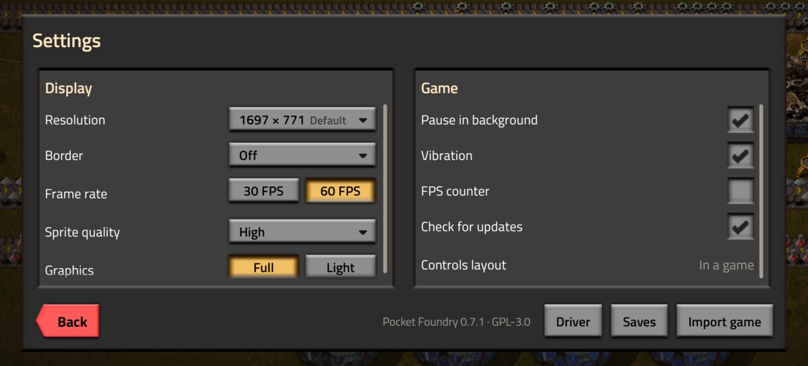
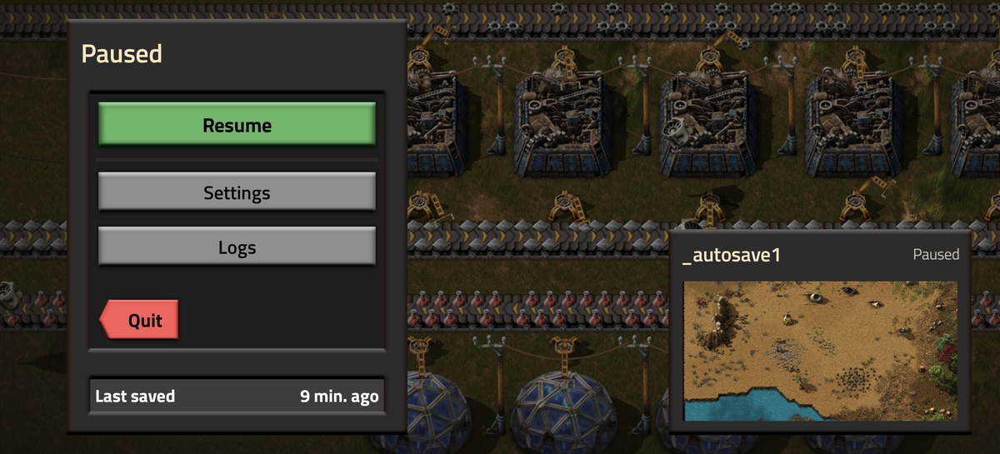

# Playing

## Controls

Factorio runs in its gamepad mode, so its hints and the tutorial ("press A", "hold LB") name the buttons on screen.
Your finger is the cursor: touch the game where you want something to happen.

| On the game | What it does |
|---|---|
| Tap | Moves the cursor there and acts on it, like A: places what you hold, opens what's there. In menus, it clicks. |
| Double tap, keep the finger down and drag | Holds A along the way: a line of belts or pipes. |
| Long press | Mines what's under the finger (holds X); drag to keep mining. |
| Two-finger tap | B: closes a menu, goes back, dismisses a tutorial tip. |
| Pinch | Zooms in and out. |

The square on the right is a trackpad, like a laptop's or the Steam Deck's: drag in it and the cursor moves by how far
you drag, so your finger never covers what you point at. Tap in it to act where the cursor is, long press for X, and
double tap and hold to hold A while you drag. **Settings -> Touch** changes it: **Direct** puts a right stick there
instead, **Trackpad** makes the whole screen a trackpad, and **Trackpad speed** sets how far the cursor goes.

| Button | In Factorio |
|---|---|
| Left stick | Walk. |
| Trackpad (the square on the right) | Moves the cursor, see above. A right stick with Touch on Direct. |
| R3 (the small R above it) | Shows a cross next to the player, which the trackpad or right stick moves. |
| Y (the largest) | Inventory and crafting. |
| A | Build, open, craft, pick up. |
| X | Mine, craft 5. |
| B | Close, back, empty the hand. |
| LB (hold) | Quick panel: items and tools without opening the inventory. |
| RT, LT | Held with another button for more: RT + A builds a ghost, LT + map opens research. |
| RB | Shoot. |
| D-pad | Right rotates, down picks up items, up shows details on the map. |
| The two under the toolbar | Map and game menu. |

The toolbar at the top moves and resizes the buttons (pinch one), removes them and adds them back, fades or hides
them all, and opens the phone's keyboard, for naming a save. Back, or a controller's
home button, opens the pause menu; the game freezes while it's off screen.

## Controllers

USB or Bluetooth: Xbox, PlayStation, Switch Pro, 8BitDo, phone clamps.

- The on-screen buttons step aside as soon as you use one, and come back when it's unplugged. A handheld's own
  controls count from the start.
- Touch still moves the cursor, and the game's rumble comes through the controller.
- The launcher takes it too: the D-pad or stick moves between buttons, A picks and B goes back.
- The game names the buttons the Xbox way; Factorio's own settings can show PlayStation or Switch symbols instead.

## Keyboards

Connected when the game starts without a controller, a USB or Bluetooth keyboard puts Factorio in its
keyboard-and-mouse mode and the on-screen controls step aside. A mouse points and clicks as on a computer; touch
still works as the mouse too.

## Settings

- **Resolution** the game draws at. Default comes from the screen's density, so the game looks the same size on any
  phone. The two below it, the lowest marked CPU, keep the same view with fewer pixels.
- **Frame rate** capped at 30 or 60 FPS; the game keeps 60 updates a second.
- **A frame** round the game, which keeps the screen's rounded corners off its menus.
- **Sprite quality:** Medium takes about 700 MB off the phone's shared memory, for very big saves or Mali GPUs.
- **Graphics:** Light turns off Factorio's smoke, clouds, decoratives, particles, shadows and terrain effects, which
  roughly halves what the phone draws. Full puts them back.
- **Driver:** see [Phones and drivers](phones.md).
- **FPS counter** in the game's top-left corner.
- **Fast start:** Factorio keeps the sprite atlases it builds on the phone's storage (about 130 MB for the base game
  with Medium sprites, shown next to it), so every start after the first loads in seconds and with a third less
  memory. It builds them again when the sprites, the mods or the driver's texture compression change. Off, it frees
  the room.
- **Detailed logs:** for a problem report. Logs then also shows how the game's frames get to the screen, the game's
  memory and every graphics error. A black screen or a frozen picture shows where it happens. Turn it on, play until
  the problem shows, then copy the Logs.
- Pausing in the background, and vibration.

## Updates

Pocket Foundry doesn't check for updates itself. [Obtainium](https://github.com/ImranR98/Obtainium) does: add
Pocket Foundry with the button in the [README](../README.md#getting-started), or paste this repository's link into
Obtainium, and it tells you when a new version is out and installs it. Each version installs over the last and keeps
the game and saves. To get the betas too, turn on **Include prereleases** in Obtainium's settings for Pocket
Foundry.

## Game files

Factorio's own folder, with its mods, saves, config, scenarios and blueprints, shows up as **Pocket Foundry** in the
phone's Files app and in any app's file picker; **Settings -> Files** opens it. From there a mod's zip can be added
or deleted, `mod-list.json` or `config/config.ini` edited in a text editor, and a save shared. Changes to mods apply
the next time the game starts, and Pocket Foundry sets the few `config.ini` keys its own settings cover each time. The
game itself isn't in there, and neither is the factorio.com login. Factorio saves the blueprint library
(`blueprint-storage-2.dat`) when the game quits.

**Blueprint strings:** copy one on the phone, open Factorio's **Import string** and paste it from the phone keyboard's
clipboard (the keyboard button on the toolbar). Factorio offers Import string and the blueprint library once a map is
far enough along.

## Saves

Settings -> Saves exports them all to `Download/Pocket Foundry`, which uninstalling leaves alone, and imports saves
from anywhere.

| | |
|---|---|
|  |  |
